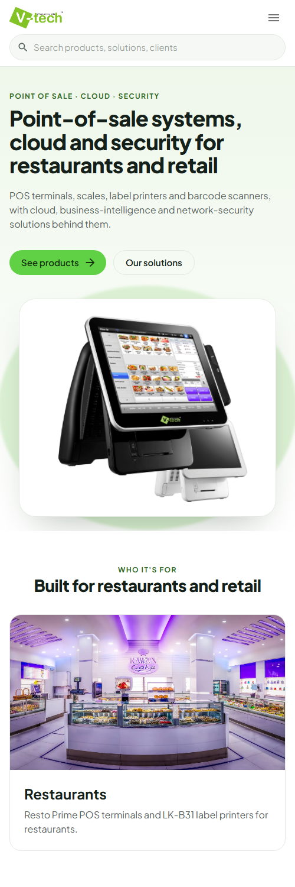

# V-tech landing page

The one-page site of V-tech: its point-of-sale products, its cloud, business-intelligence and
security solutions, and the businesses it serves.

**Live:** https://vtechlanding.vercel.app


## What it does

- **Header:** a slim bar that stays at the top, with the logo, links to the sections and a
  search box. On phones the links fold into a menu and the search box takes its own row.
- **Opening:** a headline saying what V-tech offers, one line naming the products and solutions,
  buttons to the products and the solutions, and the Resto Prime terminal.
- **Who it's for:** restaurants and retail, each with the products that serve it.
- **Best Choice Products:** six product cards, each with its photo, what it is and its name.
- **Our Solutions:** nine solutions in three groups, each with an icon.
- **Our Clients:** five client logos.
- **Search:** filters the page as you type. Every word has to appear in a product's name or type,
  a solution's name or group, or a client's name; case and accents are ignored. While searching,
  the opening steps aside, sections without matches are left out, and the result count is
  announced to screen readers.



## How it's built

Vite, React 18 and MUI v5, with no router: the site is a single page.

```
src/
  content.js        everything the page shows: opening, markets, products, solutions, clients
  search.js         the search rule (every word must match)
  theme.js          type (Plus Jakarta Sans), colours, shapes and global styles
  App.jsx           page layout and search state
  components/       Header, SearchBox, Hero, Markets, Products, Solutions, Clients, Footer,
                    Section (shared section heading), Reveal (fade-in on scroll)
public/images/      logos, product photos, market photos (WebP)
```

The footer and the Solutions section read the same list from `content.js`, so they can't drift
apart. The brand green (#60D045) is the accent colour. Text on it is dark green, because white on
that green is only 1.98:1 against the 4.5:1 WCAG asks for; dark green is 7.1:1. Green text on
white uses a deeper green (6.5:1).

## Tests

```
npm test
```

Vitest with Testing Library, 13 tests: every section and product renders; no placeholder text is
left; the Solutions section lists exactly the footer's solutions, in their groups; the header
links and the opening's buttons reach real sections, and no dead controls remain; both markets
show with their products; search filters and clears; text colours meet 4.5:1 on white, on the
tinted sections and on the green; and every image the page uses exists with the exact letter
case, since the production build runs on case-sensitive Linux.

## What was deliberately left out

The 2019 version had controls with nothing behind them. They were removed rather than left to
mislead visitors, and can come back once there's something for them to do:

- **Sign in, sign out and the profile menu:** the site has no accounts.
- **About Us, Contact Us, Partners, Downloads, Media Center, Success Story:** there was no content
  for these pages.
- **The country picker (Jordan, KSA, Canada):** it didn't change anything on the page.
- **The photo slider:** replaced by the opening and the two market cards, which show the same
  photos and text without hiding one behind the other.

## Limits

- The site has no contact details yet; a contact section needs the real phone, email and address.
- The products, solutions and clients are the ones from the 2019 site. The solutions have names
  but no descriptions yet.
- The logo shown for the client "Abu Tafesh" reads "Al Rifai"; one of the two is out of date.

## Run locally

Needs Node.js 18 or newer.

```
npm install
npm run dev       # http://localhost:5173
npm run build     # production build in dist/
npm run preview   # serve the production build
```

## Deploy

The site is a static build on Vercel. Vercel detects Vite on its own, so no configuration file is
needed:

```
npx vercel deploy --prod
```
